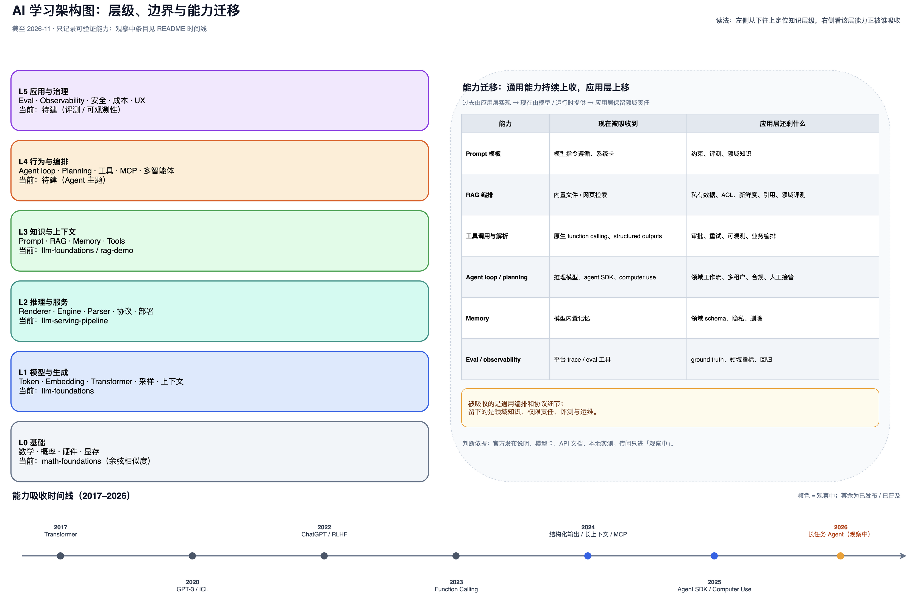

# AI 学习架构图（Living Map）

这是一份跨 topic 的元文档，不是学习 topic。它回答三个问题：

1. 现在学的知识落在哪一层？
2. 每一层的边界正在往哪边移动？
3. 哪些能力已经被模型/运行时吸收，应用层还剩下什么？

架构图源文件：[ai-landscape.drawio](diagrams/ai-landscape.drawio)。规则本体见 [AGENTS.md](../AGENTS.md)，理论依据见 [learning-model.md](../learning-model.md)。

## 分层架构

从下往上看：L0 是底座，L5 是应用与治理。越往上，越接近业务问题；越往下，越接近模型和计算。

| 层级 | 关注点 | 当前 topic / 产物 | 边界判断 |
| --- | --- | --- | --- |
| L0 基础 | 数学、概率、硬件、显存 | [math-foundations](../math-foundations/)（余弦相似度） | 数学只在与上层现象直接相关时下钻；概率与硬件待调研 |
| L1 模型与生成 | 架构、token、采样、上下文 | [llm-foundations](../llm-foundations/) | 上下文、多模态能力持续被模型上收 |
| L2 推理与服务 | Renderer/Engine/Parser、协议、部署 | [llm-serving-pipeline](../llm-serving-pipeline/) | 托管 API 吸收部署与协议细节 |
| L3 知识与上下文 | prompt、RAG、memory、tools | [rag-demo](../llm-foundations/rag-demo/) | 内置检索/文件搜索吸收通用 RAG 编排；MCP 只是接入方式，不替代上下文注入 |
| L4 行为与编排 | agent loop、planning、工具、MCP、多智能体 | 待建 | 推理模型/agent SDK 吸收通用 loop；Agent 决定何时调用检索工具 |
| L5 应用与治理 | eval、observability、安全、成本、UX | 待建 | 评测与治理仍留在应用层 |

跨层维度：**评测、安全、成本**。它们不属于某一层，但每一层都要回答这三个问题。

## 能力边界表

这张表记录「过去在应用层、现在被吸收」的能力。判断依据是发布说明、官方文档或本地实测，不采信传闻。

| 能力 | 过去在应用层 | 现在被吸收到 | 应用层还剩什么 |
| --- | --- | --- | --- |
| Prompt 模板 | 手写模板、框架 | 模型指令遵循、系统卡 | 约束、评测、领域知识 |
| RAG 编排 | LangChain、LlamaIndex 等 | 内置文件/网页检索 | 私有数据、ACL、新鲜度、引用、领域评测 |
| 工具调用与解析 | 手写 parser | 原生 function calling、structured outputs | 审批、重试、可观测、业务编排 |
| Agent loop / planning | agent 框架 | 推理模型、agent SDK、computer use | 领域工作流、多租户、合规、人工接管 |
| Memory | 自建向量记忆 | 模型内置记忆 | 领域 schema、隐私、删除 |
| Eval / observability | 自建 | 平台 trace / eval 工具 | ground truth、领域指标、回归 |

一句话结论：**被吸收的是通用编排和协议细节，留下的是领域知识、权限责任、评测与运维。** 这也是选择学习重点的依据。

## 能力吸收时间线

只记录已发布、可验证的能力。预测和传闻放在下面的「观察中」表，不混进主时间线。

| 时间 | 能力 / 事件 | 边界变化 | 状态 |
| --- | --- | --- | --- |
| 2017 | Transformer | 注意力成为通用底座 | 已普及 |
| 2020 | GPT-3 / in-context learning | prompt 成为应用层技能 | 已普及 |
| 2022 | ChatGPT / RLHF | 对话与对齐上收到模型 | 已普及 |
| 2023 | function calling | 工具调用从框架上收到模型 API | 已普及 |
| 2023–2024 | RAG 框架流行 | 检索编排成为应用层主战场 | 已普及 |
| 2024 | structured outputs、长上下文、computer use、MCP、推理模型 | 解析、上下文、工具接入被标准化 | 已发布 / 已普及 |
| 2025 | agent SDK、computer use 普及、MCP 采用 | 通用 loop 与执行上收到模型/运行时 | 观察中 / 已发布 |
| 2026 | 长任务 agent、agentic coding | 边界待定 | 观察中 |

状态定义：

- **已普及**：能力已经进入主流模型或运行时，应用层不再需要自己实现
- **已发布**：有明确发布说明或官方文档，但采用程度还需观察
- **观察中**：方向明确，但缺少稳定证据；不能据此调整学习重点
- **预测**：尚未发生，只用于记录假设

### 观察中

| 日期 | 观察项 | 可能影响的层 | 需要什么证据 | 复核日期 |
| --- | --- | --- | --- | --- |
| 2026-11-11 | agent loop / planning 是否被模型/运行时完全吸收 | L4 | 官方 agent SDK 能力边界、真实任务实测 | 2027-02 |
| 2026-11-11 | 内置检索是否会取代通用 RAG 框架 | L3 | 私有数据接入、权限、引用能力的实测 | 2027-02 |

## 变更记录

| 日期 | 变化 | 影响层 / topic | 证据 | 状态 |
| --- | --- | --- | --- | --- |
| 2026-11-11 | 建立 AI 学习架构图 v0.1 | L0–L5 | [AGENTS.md](../AGENTS.md)、两个 topic 的定位段 | 已沉淀 |
| 2026-11-11 | 记录 RAG 子模块（BM25 + 向量） | L3 / [rag-demo](../llm-foundations/rag-demo/) | [sample-vector-output.txt](../llm-foundations/rag-demo/sample-vector-output.txt) | 已沉淀 |
| 2026-11-11 | 记录「通用编排被吸收」的初步判断 | L3–L4 | 待补发布说明与实测 | 观察中 |
| 2026-11-11 | 新增 L0 [math-foundations](../math-foundations/)，先落余弦相似度 | L0 | 手算 (3,4) vs (4,3) = 0.96，以及 [向量 RAG 真实分数](../llm-foundations/rag-demo/sample-vector-output.txt) 0.6556 / 0.1942 | 实验中 |
| 2026-11-11 | 澄清 RAG 与 MCP 的分层：MCP 属 L4 接入层，不替代 L3 的上下文注入 | L3–L4 | [production.md](../llm-foundations/rag-demo/production.md) 的「流水线 RAG vs Agent 工具」 | 已沉淀 |

## 维护规则

### 触发更新的条件

- 新增、重命名、合并或拆分 topic
- 出现改变边界的新能力（模型、运行时、协议、托管服务）
- 现有 topic 的结论发生变化
- 每季度一次的边界复盘

### 更新流程

1. 先改本文件的边界表或时间线，写清证据和状态
2. 再更新 `ai-landscape.drawio` 与 PNG
3. 同步受影响 topic 的「定位」段
4. 在「变更记录」追加一行
5. 如果新增了 topic，同步更新 [AGENTS.md](../AGENTS.md) 的索引

### 证据标准

- 官方发布说明、模型卡、API 文档
- 本地可复现的实验或抓包
- 可信的工程实践报告

不把「我觉得」「听说」「社区都在说」写进主时间线；这些只能进「观察中」，并标注需要什么证据。

### 季度复盘清单

- [ ] 边界表里「应用层还剩什么」是否仍然成立？
- [ ] 时间线里「观察中」的条目，有没有足够证据升级或删除？
- [ ] 是否出现了新的抽象层，需要调整六层结构？
- [ ] 现有 topic 的「定位」段是否与图一致？
- [ ] 是否有 topic 的边界被其他 topic 侵入，需要合并或拆分？

## 文件

| 文件 | 说明 |
| --- | --- |
| `README.md` | 本文件：分层、边界、时间线、变更记录 |
| `diagrams/ai-landscape.drawio` | 架构图源文件 |
| `diagrams/ai-landscape.png` | 导出的预览图 |
