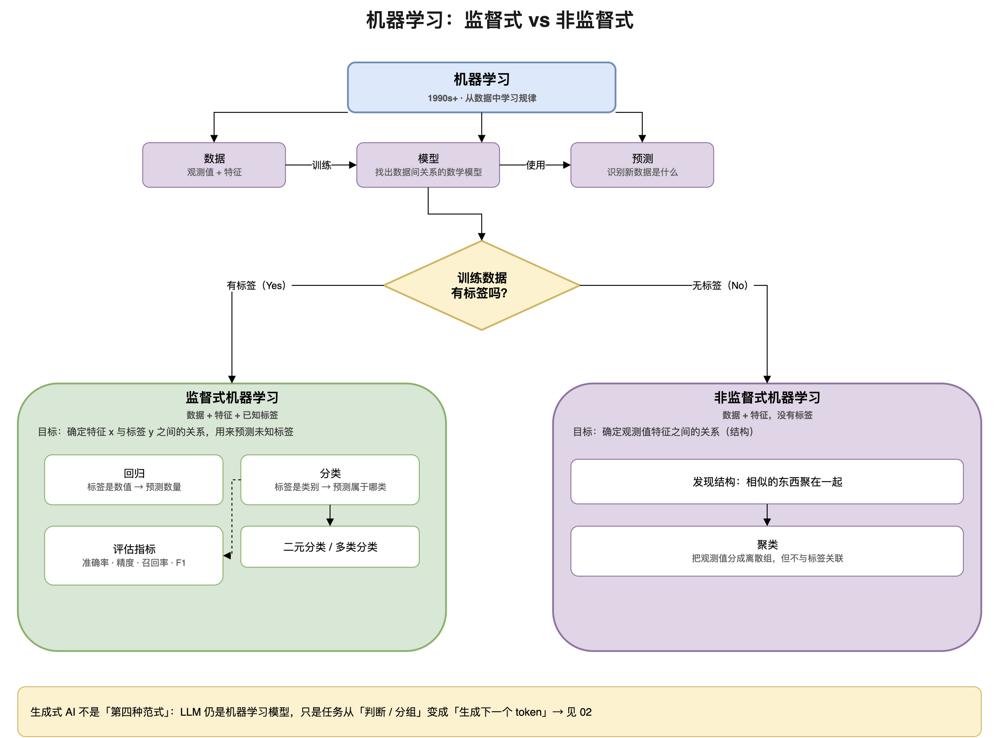
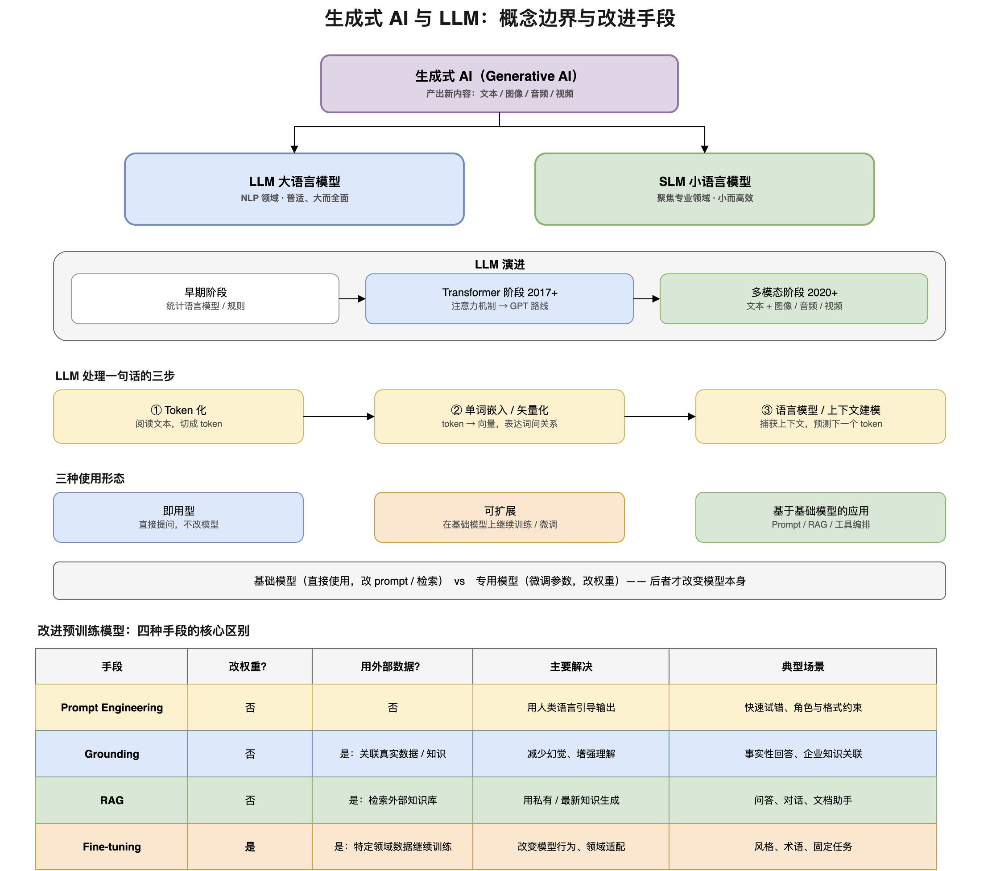
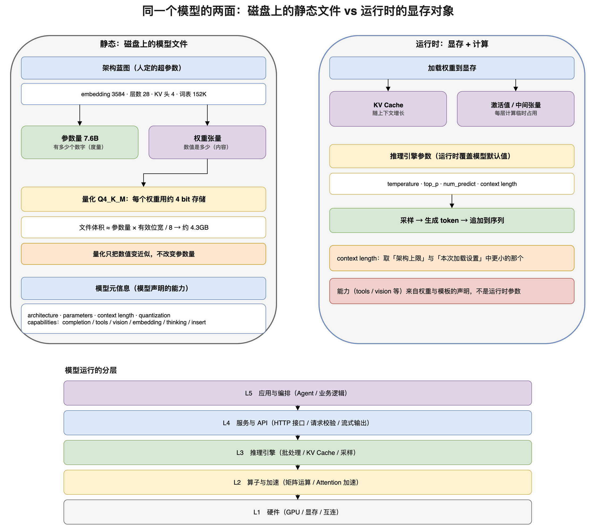
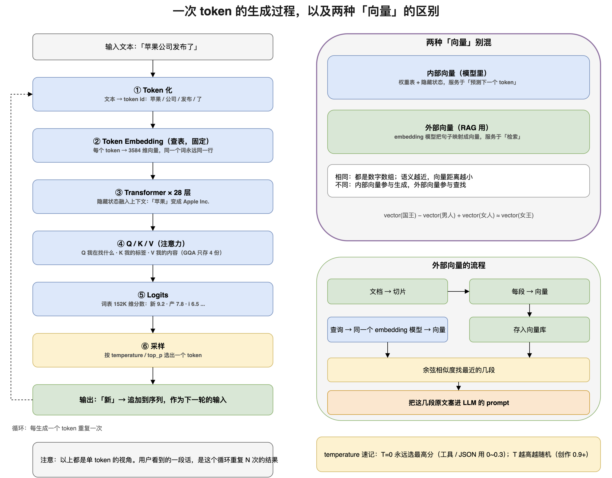

# LLM 前置理论：把概念摆正

> 状态：已沉淀（2026-11-11）。目标不是学数学，而是**建立一套能支撑后续 Agent 开发的概念框架**。

## 定位

- 层级：L1 模型与生成
- 前置：无
- 后续：llm-serving-pipeline（L2）、Agent（L4）
- 负责：ML/LLM 前置概念、模型静态与运行时、token 生成、内部/外部向量，以及最小 RAG demo
- 不负责：推理引擎实现、Agent 编排、生产 RAG 的向量库与运维
- 架构图：[../ai-map/README.md](../ai-map/README.md)

## 这份笔记解决什么问题

后面要写 Agent、要看推理服务、要选模型，会遇到一堆听起来相似的名词：

- 机器学习 / 深度学习 / 生成式 AI / LLM
- 监督 / 非监督
- 参数 / 权重 / 参数量 / 量化
- 预训练 / 微调 / RAG / Grounding / Prompt Engineering
- 内部向量 / 外部向量

这份笔记只用**足够浅**的方式把它们摆到正确的位置，不推导公式。需要深入推理层实现时，转到 [llm-serving-pipeline](../llm-serving-pipeline/)。

## 一张图看懂全局



对应的源文件：[01-ml-taxonomy.drawio](diagrams/01-ml-taxonomy.drawio)

## 机器学习：三个词、两条路

机器学习的全部内容可以先压缩成三个词：

| 概念 | 是什么 | 工程类比 |
| --- | --- | --- |
| 数据 | 观测值 + 特征 | 一批带上下文的输入样本 |
| 模型 | 找出数据之间关系的**数学模型** | 一个带参数的函数 |
| 预测 | 用模型识别新数据 | 调用这个函数 |

再往后是工程问题：**数据科学负责训练模型，软件工程负责把模型嵌进系统**。

### 监督 vs 非监督：只差「有没有标注数据」

> 非监督式也常叫「无监督」（unsupervised），两种说法指同一件事。

| | 监督式 | 非监督式 |
| --- | --- | --- |
| 输入 | 数据 + 特征 + **已知标签** | 数据 + 特征 |
| 标签的作用 | 明确告诉模型应该输出什么 | 没有标准答案 |
| 目标 | 学「特征 x → 标签 y」的关系 | 找特征之间的关系 / 结构 |
| 典型任务 | 回归、分类 | 聚类 |
| 一句话 | 有老师批改作业 | 自己找规律 |

注意：这里的「监督」不是人盯着模型训练，而是**标注数据在监督模型**。

### 回归 vs 分类：看标签是什么类型

| | 回归 | 分类 |
| --- | --- | --- |
| 标签 | 数值 | 类别 |
| 输出 | 预测一个数量 | 预测属于哪一类 |
| 例子 | 预测房价、预测响应耗时 | 判断邮件是否垃圾、判断 MR 是否有风险 |
| 细分 | — | 二元分类、多类分类 |

### 四个指标：用真实场景记

场景：线上 100 个 MR，真正会导致故障的有 10 个。规则标记了 12 个「有风险」，其中 8 个真出事，4 个误报；另有 2 个真出事的 MR 没被标记。

| 指标 | 一句话 | 对应数字 |
| --- | --- | --- |
| 准确率 Accuracy | 所有判断里，对的比例 | (8 + 86) / 100 = 94% |
| 精度 Precision | 说「有问题」的里面，真有问题的比例 | 8 / 12 = 67% |
| 召回率 Recall | 真「有问题」的里面，被抓到的比例 | 8 / 10 = 80% |
| F1 | 精度和召回的调和平均 | 约 73% |

记忆方式：

- **精度**关心「别冤枉好人」
- **召回**关心「别放过坏人」
- **F1** 是两者的折中；两者冲突时，先问业务更怕哪一种错

## 从机器学习到生成式 AI



对应源文件：[02-llm-landscape.drawio](diagrams/02-llm-landscape.drawio)

### LLM 不是「第四种机器学习」

它仍然是机器学习模型，只是任务从「判断 / 分组」变成了「生成下一个 token」。

GPT 这个词就能说明路线：**G**enerative（生成式）+ **P**re-trained（预训练）+ **T**ransformer（架构）。

### LLM vs SLM

| | LLM 大语言模型 | SLM 小语言模型 |
| --- | --- | --- |
| 定位 | 普适，大而全面 | 聚焦专业领域 |
| 特点 | 能力强、成本高 | 小而高效、可本地跑 |
| 典型用法 | 通用助手、复杂推理 | 垂直任务、端侧 / 私有部署 |

### LLM 的三个阶段

```text
早期阶段  →  Transformer 阶段（2017+）  →  多模态阶段（2020+）
统计 / 规则     注意力机制 + 预训练            文本 + 图像 / 音频 / 视频
```

### 语言模型处理一句话的三步

1. **Token 化**：阅读文本，切成 token
2. **单词嵌入 / 矢量化**：把 token 变成向量，用距离表达词与词的关系
3. **语言模型 / 上下文建模**：结合上下文，预测下一个 token

模型之间的主要差异，来自**训练数据**以及**注意力在架构里如何实现**。

### 三种使用形态

| 形态 | 做了什么 | 是否改变模型 |
| --- | --- | --- |
| 即用型 | 直接提问 | 否 |
| 可扩展 | 在基础模型上继续训练 / 微调 | **是** |
| 基于基础模型的应用 | Prompt / RAG / 工具编排 | 否 |

基础模型 = 直接使用；专用模型 = 微调参数后使用。

### 改进预训练模型的四种手段

| 手段 | 改权重？ | 用外部数据？ | 主要解决 | 典型场景 |
| --- | --- | --- | --- | --- |
| Prompt Engineering | 否 | 否 | 用人类语言引导输出 | 快速试错、角色与格式约束 |
| Grounding | 否 | 是：关联真实数据 / 知识 | 减少幻觉、增强理解 | 事实性回答 |
| RAG | 否 | 是：检索外部知识库 | 用私有 / 最新知识生成 | 问答、对话、文档助手 |
| Fine-tuning | **是** | 是：特定领域数据继续训练 | 改变模型行为、领域适配 | 风格、术语、固定任务 |

一句话区分：

- **Prompt** 是「把话说清楚」
- **Grounding** 是「把答案锚到真实数据上」
- **RAG** 是「先去资料库查，再回答」
- **Fine-tuning** 是「继续训练，改模型本身」

Prompt Engineering 的优势：不需要复杂编程知识，直接用人类语言提问；现在的大模型除直接提问外，还支持角色设定等元数据。

### few-shot 与 in-context learning

GPT-3 论文（[Language Models are Few-Shot Learners](https://arxiv.org/abs/2005.14165)，2020）把「不更新权重、只在上下文里给示例」系统化，并定义了三个档位：

| 档位 | 上下文里给什么 | 改权重 | GPT-3 里的典型 K |
| --- | --- | --- | --- |
| zero-shot | 只有任务描述 | 否 | 0 |
| one-shot | 任务描述 + 1 个示例 | 否 | 1 |
| few-shot | 任务描述 + K 个示例 | 否 | 10–100（受 2048 context 限制） |

一个 few-shot 请求在消息层面长这样（翻译任务）：

```text
user:      把英文翻译成中文：sea otter
assistant: 海獭
user:      把英文翻译成中文：cheese
assistant: 奶酪
user:      把英文翻译成中文：keyboard
```

模型看到的是「同一格式的第 3 个问题」，于是按前面的模式补全。没有梯度下降，没有新权重；示例只是这次请求 context 的一部分。

三个概念别混：

| | few-shot prompting（本篇） | fine-tuning | ML 里的 few-shot learning |
| --- | --- | --- | --- |
| 示例放哪 | prompt 里 | 训练集里 | 支持集里 |
| 是否改权重 | 否 | 是 | 通常会 |
| 生效范围 | 仅这次请求 | 持久 | 任务内 |
| 数据量 | 几条 | 几千到几十万条 | 每类几条，但要先 meta-train |

最后一列不是同一个东西：ML 的 few-shot learning 通常指 meta-learning（先在大量任务上训练，遇到新任务再用少量标注快速适应）；GPT-3 的 few-shot 是纯前向的 in-context learning。论文自己说两者相关，但机制不同。

为什么有效？论文没有给出定论，只列了两种可能：

1. 模型在推理时真的从零学会了新任务；
2. 模型只是在预训练数据里见过类似任务，示例帮它识别出该调用哪个已有能力。

词打乱这类人工任务更支持第 1 种：zero-shot 几乎不会，few-shot 明显会；翻译则显然依赖预训练。真实情况大概率是光谱，逐任务不同。

论文实测（175B）：

| 任务 | zero-shot | one-shot | few-shot | 备注 |
| --- | --- | --- | --- | --- |
| CoQA（F1） | 81.5 | 84.0 | 85.0 | 接近甚至超过部分微调模型 |
| TriviaQA | 64.3 | 68.0 | 71.2 | 闭卷 setting 下的 SOTA |
| 2 位加法 | — | — | 100% | 3 位加法 80.2%，2 位乘法 29.2% |
| 单词去随机插入字符 | 几乎不会 | 明显下降 | 66.9% | one-shot 比 few-shot 掉一半以上 |

三个容易误读的点：

1. **few-shot 不是「用少量数据微调」。** 权重没变；换个请求，示例就消失了。
2. **示例不是越多越好。** 论文说 K 通常越大越好，但不总是；K 受 context 限制，且示例格式必须和目标一致。实践中在 dev 集上试几个 K。
3. **few-shot 也有明显失败。** ANLI、WiC、QuAC、RACE 等「比较 / 蕴含 / 长文阅读」任务上接近随机；论文归因于单向架构不擅长回看和比较。示例救不了架构和任务不匹配。

本地对应证据：[cot-demo](../cot-demo/) 里的 few-shot CoT 就是「few-shot + 推理过程」：同一道题 plain 答错（`35支`），zero-shot CoT 答对（`49`，221 tokens），few-shot CoT 也答对（`49`，64 tokens）。few-shot 在这里主要省 token——模型直接模仿示例格式，不需要被反复劝说。

和 thinking 模型的关系：thinking 把「先推理再回答」训练进权重，few-shot 只是在上下文里临时给模式；前者跨请求生效，后者只对这次请求生效。

## 模型到底是什么：静态文件 vs 运行时



对应源文件：[03-model-anatomy.drawio](diagrams/03-model-anatomy.drawio)

### 先学会读模型名字

```text
Qwen 2.5 - 7B - Instruct - 1M
  │     │     │      │       │
  │     │     │      │       └─ 上下文规格（如 128K / 1M）
  │     │     │      └─ 后训练阶段：指令微调版（对话、Agent 调用）
  │     │     └─ 参数量档位（约 70 亿）
  │     └─ 系列版本号
  └─ 模型家族名
```

### 参数 vs 权重：最容易混的一对

| | 参数 / 参数量 | 权重 |
| --- | --- | --- |
| 回答的问题 | **有多少个**数字 | 每个数字**是多少** |
| 工程类比 | 数组的长度 | 数组里的元素 |
| 会不会变 | 架构定了就不变 | 微调会改 |
| 影响 | 模型规模、显存需求 | 模型能力、行为 |

所以：**参数量相同，权重不同，模型文件大小也会不同**。

### 量化：只改精度，不改数量

量化（quantization）是把权重数值用更少的 bit 表示：

```text
文件体积 ≈ 参数量 × 有效位宽 / 8

7.6B × 4 bit / 8 ≈ 3.8GB（实际 gguf 约 4.3GB，含元数据等开销）
```

- Q4_K_M 表示约 4-bit 量化
- 量化后数值变成近似值，**参数量不变**
- 目的：省显存、省磁盘、跑得更快，用少量精度换成本

### 模型元信息看什么

```bash
ollama show qwen2.5
```

| 字段 | 含义 |
| --- | --- |
| architecture | 架构 id，如 qwen2 |
| parameters | 参数量，如 7.6B |
| context length | 上下文上限（还受本次加载设置影响） |
| embedding length | 每个 token 的向量维度，如 3584；维度越高表达力越强，计算也越贵 |
| quantization | 量化精度，如 Q4_K_M |
| capabilities | 模型声明支持的能力 |
| system | 自带 system prompt |
| license | 许可证 |

### 能力（capabilities）不是运行参数

| 能力 | 含义 |
| --- | --- |
| completion | 文本生成（所有生成式模型都有） |
| tools | chat template 含工具调用分支，可走 tools 参数 |
| vision | 有视觉投影器，能收图 |
| embedding | 纯向量模型，只做 embedding |
| thinking | 支持思考块，可传 `think: true/false` |
| insert | 支持 FIM（Fill-In-the-Middle），可传 suffix |

这些是**模型权重和模板声明**的，不是运行时随便打开的开关。

### 模型运行的五层

```text
L5  应用与编排        你的 Agent / 业务逻辑
L4  服务与 API        HTTP 接口、请求校验、流式输出
L3  推理引擎          批处理、KV Cache、采样
L2  算子与加速        矩阵运算、Attention 加速
L1  硬件              GPU / 显存 / 互连
```

一般说的「改模型参数」，改的其实是 **L3 推理引擎暴露的参数**（temperature、top_p、num_predict 等），和模型文件本身没关系。

## 一次 token 是怎么生成的



对应源文件：[04-token-pipeline.drawio](diagrams/04-token-pipeline.drawio)

以「苹果公司发布了」为例：

```text
输入文本: "苹果公司发布了"

① Token 化
   "苹果" / "公司" / "发布" / "了"  →  token id

② Token Embedding（查表，固定）
   每个 token → 3584 维向量，同一个词永远对应同一行

③ Transformer × 28 层
   隐藏状态融入上下文："苹果" 从水果变成 "Apple Inc."

④ Q / K / V（注意力）
   Q：我在找什么   K：我的标签   V：我的内容
   GQA 下 K/V 只存 4 份，省显存

⑤ Logits
   词表 152,000 维分数："新" 9.2、"产" 7.8、"i" 6.5 ...

⑥ 采样
   按 temperature / top_p 选一个 token

输出："新" → 追加到序列，循环回 ①
```

用户看到的一整段话，就是这个循环重复 N 次的结果。

### KV Cache 为什么存在

每生成一个新 token，都要和前面所有 token 做注意力计算。前面的 K/V 不变，所以缓存起来复用，避免每次重算。代价是**显存随上下文增长**，这也是长上下文贵的原因之一。

### Temperature：控制随机程度

| 温度 | 行为 |
| --- | --- |
| T = 0 | 永远选概率最高的 token（greedy） |
| T 低 | 保守、确定 |
| T = 1 | 按原始概率分布采样 |
| T 高 | 随机、发散 |

物理类比：温度低，分子待在低能量态，有序；温度高，分子乱跑，混乱。

| 场景 | 推荐值 |
| --- | --- |
| 工具调用 / JSON 输出 | 0 ~ 0.3 |
| 代码生成 | 0.1 ~ 0.3 |
| 数学 / 逻辑推理 | 0 ~ 0.2 |
| 事实问答 | 0.3 ~ 0.5 |
| 日常对话 | 0.7 |
| 营销文案 | 0.7 ~ 0.9 |
| 诗歌 / 故事 | 0.9 ~ 1.2 |
| 头脑风暴 | 1.2+ |

用 Python 感受一下「温度改变分布」：

```python
import math

logits = {"新": 9.2, "产": 7.8, "i": 6.5}
temperature = 0.5

scaled = {k: v / temperature for k, v in logits.items()}
top = max(scaled.values())
probs = {k: math.exp(v - top) for k, v in scaled.items()}
total = sum(probs.values())
probs = {k: p / total for k, p in probs.items()}

print(probs)  # T 越低，"新" 的占比越接近 1
```

## 两种「向量」别混

| | 内部向量 | 外部向量 |
| --- | --- | --- |
| 谁产生 | 模型权重 / 隐藏状态 | 独立的 embedding 模型 |
| 表示什么 | 单个 token 的上下文表示 | 一段文本（句子 / 段落） |
| 用来做什么 | 预测下一个 token | 检索相似内容 |
| 存在哪 | 权重文件 / 显存 | 向量库 |
| 场景 | 生成 | RAG |

嵌入的本质：**把非结构化数据映射到连续向量空间，让语义相近的内容在空间里更接近**。

```text
vector("国王") − vector("男人") + vector("女人") ≈ vector("女王")
```

RAG 的外部向量流程：

```text
文档 → 切片 → embedding 模型 → 每段一个向量 → 存向量库
查询 → 同一个 embedding 模型 → 一个向量
     → 点积 / 余弦相似度，找最近的几段
     → 把这几段原文塞进 LLM 的 prompt
```

注意「同一个 embedding 模型」：建库和查询必须用同一个模型，否则向量空间不一致，距离没有意义。

余弦相似度的直观解释与手算例子，见 L0 笔记 [math-foundations](../math-foundations/)。

上面的流程有一份可跑的最小实现：[rag-demo/](rag-demo/)。`rag.py` 用 BM25 检索，`vector_rag.py` 用 `qwen3-embedding:0.6b` 算向量余弦，两份实现共用切片与 prompt 拼接，只换打分器。可以直接看 [sample-output.txt](rag-demo/sample-output.txt) 和 [sample-vector-output.txt](rag-demo/sample-vector-output.txt) 里的真实 prompt、检索分数与回答。生产环境要补的 embedding 选型、切片策略、向量库、混合检索与评测，见 [production.md](rag-demo/production.md)。

## 概念辨析速查

| 容易混的 | 区别 |
| --- | --- |
| 参数量 vs 权重 | 数量 vs 数值；参数量是数组长度，权重是数组元素 |
| 参数量 vs 文件大小 | 文件大小 ≈ 参数量 × 位宽 / 8，量化会变小 |
| 量化 vs 微调 | 量化改数值精度；微调改数值本身 |
| 预训练 vs 微调 | 预训练学通用规律；微调在特定数据上继续训练 |
| Prompt vs RAG vs Grounding vs Fine-tuning | 前三个不改权重；只有微调改 |
| few-shot prompting vs fine-tuning | 前者示例只在这次 context 里，后者把数据训进权重 |
| few-shot prompting vs ML few-shot learning | 前者纯前向不改权重；后者通常指 meta-learning + 少量标注适应 |
| 上下文长度 vs 参数量 | 上下文是「一次能看多少 token」；参数量是「模型多大」 |
| 模型能力 vs 运行参数 | 能力由权重 / 模板声明；temperature 等是运行时参数 |
| LLM vs SLM | 通用大模型 vs 专用小模型，不是架构代差 |
| 内部向量 vs 外部向量 | 服务于生成 vs 服务于检索 |
| 准确率 vs 精度 vs 召回率 | 全对比例 vs 别冤枉 vs 别放过 |

## 和推理服务笔记的关系

这份笔记讲「概念在哪一层」，[llm-serving-pipeline](../llm-serving-pipeline/) 讲「那一层怎么实现」：

| 这里的概念 | 推理流水线里的位置 |
| --- | --- |
| Token 化 / 模板 | `Renderer` |
| 模型权重 + Transformer | `Engine` |
| 采样 / temperature | `Engine` 的采样阶段 |
| 上下文长度 / KV Cache | `Engine` 的资源约束 |
| 模型能力 / tools | 模板与 `ProtocolParser` |
| 向量 / RAG | Agent 侧的外部检索，不在推理引擎内 |

## 待验证 / 下一步

- [ ] 用本地 qwen2.5 跑一组 temperature 对比，直观感受稳定性差异
- [x] 用 Python 写一个最小 RAG，观察检索片段如何进入 prompt → [rag-demo/](rag-demo/)（BM25 + 向量两版）
- [x] CoT 对照实验：同一模型的直接回答、零样本 CoT、few-shot CoT → [cot-demo/](cot-demo/)
- [x] 观察 thinking 模型的 think 开关、字段分离、流式相位与 Engine 原始 delta → [thinking-demo/](thinking-demo/)
- [x] 读 GPT-3 原文，核对 zero / one / few-shot 的定义、证据与失败模式 → 本文件「few-shot 与 in-context learning」
- [ ] 用 `ollama show` 对比不同模型的能力声明（tools / thinking / vision）
- [ ] 估算一次推理的显存占用：权重 + KV Cache + 激活值
- [ ] 看 chat template 如何把 tools 注入 system prompt（见推理服务笔记）

## 目录

```text
llm-foundations/
├── README.md
├── diagrams/
│   ├── 01-ml-taxonomy.drawio / .png          # 监督 vs 非监督、回归 vs 分类
│   ├── 02-llm-landscape.drawio / .png        # LLM vs SLM、改进四手段
│   ├── 03-model-anatomy.drawio / .png        # 静态文件 vs 运行时、五层运行栈
│   └── 04-token-pipeline.drawio / .png       # 一次 token 生成、内部 vs 外部向量
├── rag-demo/
│   ├── README.md                             # 最小 RAG 的分步说明与观察点
│   ├── production.md                         # 生产环境：embedding / 切片 / 向量库 / 评测 / 运维
│   ├── rag.py                                # BM25 检索：切片 / 打分 / 拼 prompt / 调 Ollama
│   ├── vector_rag.py                         # 向量检索：embedding / 余弦 / 向量缓存
│   ├── embeddings.json                       # 12 × 1024 维切片向量缓存（自动生成）
│   ├── docs/                                 # 6 篇知识库文档
│   ├── sample-output.txt                     # BM25 版真实运行输出
│   ├── sample-vector-output.txt              # 向量版真实运行输出
│   └── sample-out-of-scope.txt               # 超纲问题的真实运行输出
├── cot-demo/
│   ├── README.md                             # 三种提示的命令、原始输出与观察点
│   ├── cot_compare.py                        # plain / zero-shot CoT / few-shot CoT 对照
│   └── sample-output.txt                     # 完整原始请求与响应 JSON
└── thinking-demo/
    ├── README.md                             # think 开关、字段分离、流式相位、Engine 原始 delta
    ├── thinking_compare.py                   # think=true / false 对照
    ├── stream_thinking.py                    # 流式观察 thinking → content
    ├── engine_raw_delta.py                   # raw + think=false 取引擎原文，重放标签切分
    ├── sample-output.txt                     # 非流式对照的完整原始输出
    ├── sample-stream.txt                     # 流式观察的完整原始输出
    └── sample-engine-delta.txt               # Engine 原始 delta 与切分的完整原始输出
```
